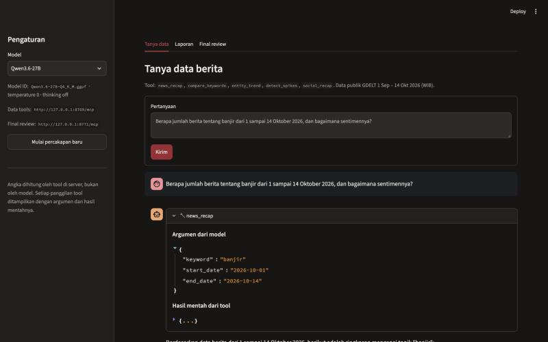
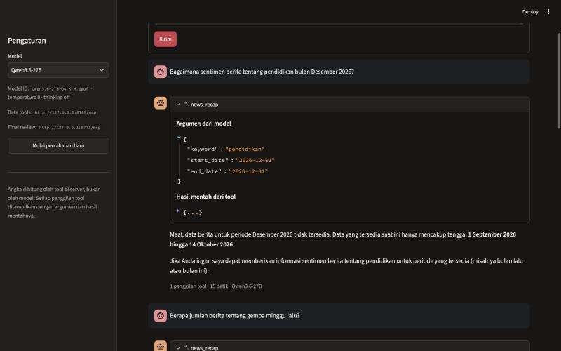
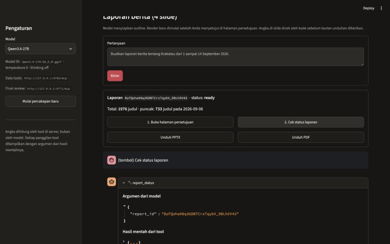
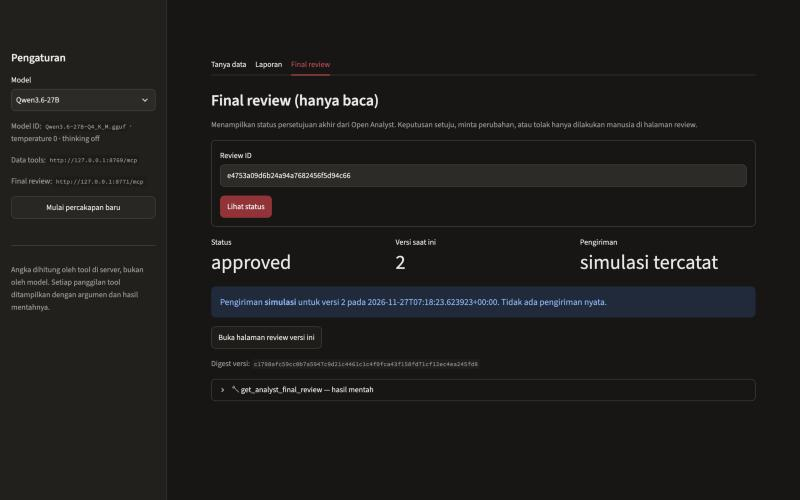

# Streamlit demo

A small web page for the same tools that Open WebUI uses. It talks to the running MCP server and to an
OpenAI-compatible model. It adds no data logic: every number comes from the MCP tools, and each tool call is
shown with the model's arguments and the raw result.

One chat, like Open WebUI. Tools are off by default, so the model first answers as a plain chatbot.
Switch tools on inside the chat with **➕ Tools**:

| Tool group | Tools | What you get |
|---|---|---|
| Social Listening | `news_recap`, `compare_keywords`, `entity_trend`, `detect_spikes`, `social_recap` | Answers with numbers from the data |
| Krakatau reports | `build_report`, `report_status` | A 4-slide outline with an approval link; after you approve on the server's page, "Cek status laporan" and PPTX/PDF download buttons |
| Final review | `get_analyst_final_review` (read-only) | Status, version and simulated delivery of an Open Analyst final review, with the review page link. Decisions are made only on the review page |

Shortcut buttons switch on the matching group and send a ready question at once: **Tanya data** (banjir,
1–14 Oct 2026), **Laporan** (Krakatau, 1–14 Sep 2026) and **Status final review** (review `e4753a09…`).
Every answer shows the tool panel next to it: tool name, the arguments and the raw data.

## Requirements

- The MCP server with reports enabled, on Streamable HTTP (see "Serve checked reports over MCP" in the main
  README). Default `http://127.0.0.1:8769/mcp`.
- For the Final review tab: `python -m slmcp.final_review serve --db ...` (default `http://127.0.0.1:8771/mcp`).
- An OpenAI-compatible chat endpoint that supports tool calls, for example llama.cpp `llama-server --jinja`.

## Run

```bash
.venv/bin/pip install -e ".[streamlit]"
.venv/bin/streamlit run apps/streamlit/app.py --server.address 127.0.0.1 --server.port 8501 \
  --server.headless true --client.toolbarMode minimal
```

Open http://127.0.0.1:8501. Keep `--server.address 127.0.0.1`: the page has no login.

## Settings (environment variables)

| Variable | Default | Meaning |
|---|---|---|
| `SLMCP_MCP_URL` | `http://127.0.0.1:8769/mcp` | Data and report tools |
| `SLMCP_REVIEW_MCP_URL` | `http://127.0.0.1:8771/mcp` | Final review service |
| `SLMCP_QWEN_BASE_URL` | `http://127.0.0.1:8000/v1` | Default model endpoint |
| `SLMCP_QWEN_MODEL` | `Qwen3.6-27B-Q4_K_M.gguf` | Default model ID |
| `SLMCP_QWEN_KEY_ENV` | (none) | Name of the variable that holds the endpoint key, if it needs one |
| `TORCONS_BASE_URL` | (none) | Adds a second, hosted model to the menu when set |
| `TORCONS_MODEL` or `MODEL_NAME` | `Torcons-Pax` | Hosted model ID |
| `TORCONS_API_KEY` | (none) | Hosted model key |

The app reads keys from the environment by name and never shows or stores them. Keep key files such as
`.env.torcons` out of git (`.env.*` is ignored). Requests use temperature 0. The default model gets
`chat_template_kwargs.enable_thinking = false` so answers are not hidden in reasoning blocks.

## Example questions

- `Berapa jumlah berita tentang banjir dari 1 sampai 14 Oktober 2026, dan bagaimana sentimennya?`
- `Berapa jumlah berita tentang gempa minggu lalu?` (the snapshot config freezes today at 15 Oct 2026)
- `Bagaimana sentimen berita tentang pendidikan bulan Desember 2026?` (outside the data: no numbers)
- Laporan: `Buatkan laporan berita tentang Krakatau dari 1 sampai 14 September 2026.`

## Tests

The tool loop lives in `agent.py` without Streamlit imports and is tested with a fake model and fake tools:
`.venv/bin/pytest tests/test_streamlit_agent.py`.

## Screenshots

Qwen3.6-27B on the public snapshot, 28 Nov 2026.

| Tab | Screenshot |
|---|---|
| Tanya data: banjir 1–14 Oct, 248 headlines, with the `news_recap` call (earlier tab layout) |  |
| Tanya data: December 2026 is outside the data, no numbers |  |
| Laporan: Krakatau 1,976 headlines, peak 733, report ready with downloads |  |
| Final review: approved version 2 with a simulated delivery |  |
